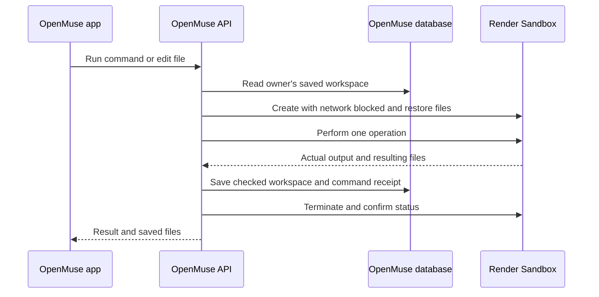

# The agent computer

OpenMuse combines a persistent browser with an optional Linux workspace for commands and files. The app and CopilotKit tools use the same authenticated computer service, so you can inspect what the agent ran and continue working with its results.

## Run the workspace on Render

A command can run in a temporary Render Sandbox while OpenMuse keeps the wanted files after it ends. For example, save `orders.json`, run a Python calculation, stop the computer, and start it later: `result.json` will still be in `/workspace`. Render Sandboxes run code in a fresh isolated environment; OpenMuse stores the completed workspace in its own database. The existing browser worker still handles web pages separately.



### Prerequisites

- A working OpenMuse API with its ordinary app login, [CopilotKit Intelligence key](https://docs.copilotkit.ai/intelligence/connect-your-runtime), and database. This provider uses the existing authenticated computer routes and agent tools.
- [Render Sandboxes](https://render.com/docs/sandboxes) enabled in an Oregon workspace. The provider uses paid **Standard** sandboxes. The default Render database storage must persist across API restarts: use an attached disk for `DATA_DIR` or a managed PostgreSQL database through `DATABASE_URL`.
- The [Render TypeScript SDK](https://render.com/docs/sandboxes-sdk-typescript), installed by `pnpm install --frozen-lockfile` in this repository. Node.js 22 or newer is required by OpenMuse.

| API-server setting | Why it is needed |
| --- | --- |
| `COMPUTER_ENABLED=true` | Enables OpenMuse's existing computer routes and tools. |
| `COMPUTER_PROVIDER=render` | Selects Render for terminal and file operations. `docker` remains the default. |
| `RENDER_API_KEY` | Lets the API server create, inspect and terminate temporary sandboxes. Create it in [Render account settings](https://dashboard.render.com/u/settings). Keep it on the API and any separate task worker, never in the app or sandbox. |
| `RENDER_WORKSPACE_ID` | Selects the paid Render workspace that owns the sandboxes. Use the `tea-...` ID for the workspace accessible to that key. |
| `DATA_DIR` or `DATABASE_URL` | Holds the saved `/workspace` files between operations. The Render API service must retain this storage. |

In the API service's Environment settings, set the two `COMPUTER_` values and your Render key and workspace ID, then restart the service. A separate task worker needs the same settings. Do not put those values into the browser worker. The `COMPUTER_IMAGE` and Docker engine settings do not apply to Render.

Open **Computer → Terminal → Start computer**, then run `pwd` or `python3 --version`. The status says **Ready** because each command or file action gets its own sandbox and the sandbox is terminated afterward. A successful command shows its real output and exit code. The Files tab shows `/workspace` content retained through Stop and Start.

A completed operation saves ordinary files and directories, up to 10 MB total and 1,000 entries. Commands run for at most 30 seconds with 128 KB of combined output. Symlinks, special files and paths outside `/workspace` are refused for saved work. If a command fails with a nonzero exit status, its changes within the size limit are still saved. If export fails or an operation is interrupted, OpenMuse keeps the previous saved workspace and reports the error. Shell processes and files outside `/workspace` do not survive a new operation.

The server checks the effective network policy before it runs code. The sandbox receives code and saved workspace files, never the app's Render or model keys. A 180-second sandbox lifetime limits the resource if the API process disappears. Termination is read back from Render after each operation. If that cannot be confirmed, new operations for that owner are blocked and **Retry cleanup** uses the recorded sandbox ID. Do not repeat an uncertain command until its outcome is inspected. A fresh command operation ID is needed only for a new intended command.

To verify the full path from a local checkout, configure the same Render key and workspace ID on the server and run `node --env-file=.env --import tsx scripts/test-render-computer.ts` from the repository root. The script uses paid sandboxes and checks a known calculation, saved file restoration, nonzero exit, timeout, owner separation and cleanup. A complete check prints `"cleanup":"terminated"` for each stage and writes sanitized details under ignored `validation-render/`.

### Use Docker on a local server

The API host needs Docker CLI access to a running Docker engine. Build the image from this repository:

```sh
docker build -t openmuse-computer:local apps/computer
```

Enable it on the API and any separate task worker, then restart them:

```dotenv
COMPUTER_ENABLED=true
COMPUTER_IMAGE=openmuse-computer:local
```

Open **Computer → Terminal → Start computer**. Run `pwd` or `python3 --version`. Commands execute inside the Linux container with `/workspace` as their default working directory. Their output, exit code, and status appear in command history.

If Docker is unavailable, the app reports the connection error. There is no fallback that executes commands on the API host.

### Optional isolated runtime on macOS

Colima is an open-source way to run Docker in a Linux VM. A separate profile keeps OpenMuse independent of other Docker workloads:

```sh
brew install colima
colima start openmuse --cpus 2 --memory 3 --disk 12 --root-disk 12 \
  --vm-type vz --activate=false --mount none --ssh-config=false
DOCKER_CONTEXT=colima-openmuse docker build -t openmuse-computer:local apps/computer
DOCKER_CONTEXT=colima-openmuse COMPUTER_ENABLED=true pnpm dev
```

The explicit context applies to that command and its child processes. It does not change the default Docker context. Stop this VM with `colima stop openmuse` when you no longer need it.

## Work with files

- **Computer → Files** lists the persistent `/workspace` directory. Create folders, add text files, edit them, and save.
- **Copy a document here** copies an owned PDF from OpenMuse into the current folder. A matching filename is replaced.
- Open a PDF in the workspace to save a copy to OpenMuse Documents and view it in the native/web reader.
- Browser downloads first enter Documents through **Import PDF downloads**, then can be copied into the Linux workspace.
- With Docker, Stop keeps the named workspace volume. With Render, OpenMuse keeps the checked workspace files in its database and restores them for the next operation.

When asking the agent to run Python, it uses the `run_computer_python` tool. The terminal sends shell commands through `run_computer_command`. Both work in the selected computer and keep their actual exit receipts.

The terminal runs bounded commands and displays their saved results. It is not an interactive PTY: full-screen terminal apps and prompts that require ongoing keyboard input are not supported. Write noninteractive scripts or edit files through the Files tab.

## Isolation and scope

With the Docker provider, the workspace is a container running as a nonroot user, with a read-only root filesystem, limited temporary storage and resources, dropped capabilities, and no added privileges. It receives no host directory mounts, Docker socket, model keys, Google tokens, or API access key. A named volume provides persistent `/workspace` storage in Docker. The Render provider uses the OpenMuse database for saved files and a fresh sandbox for each operation.

Terminal networking is disabled. The existing browser worker handles public web access through its own destination checks; see its [network boundary](../apps/worker/README.md#network-boundary). Browser profiles and workspace files have separate storage and lifecycle controls.

This is a self-hosted, single-owner computer environment. Docker isolation does not provide a dedicated operating-system VM or a hostile-tenant security guarantee. The optional Colima VM provides the Linux host on macOS; the application still manages a Docker container within it.
